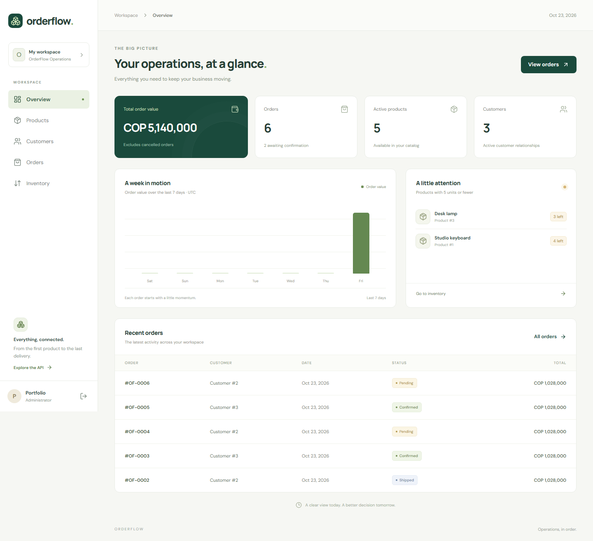

# OrderFlow

**Operations, in order.** A full-stack product, customer, inventory, and order management workspace built with FastAPI, PostgreSQL, and React.

OrderFlow demonstrates transactional business rules, concurrent stock protection, role-based access, safe database testing, and a real browser-to-database workflow. It extends the original product API rather than replacing it.



*Actual browser capture against FastAPI and PostgreSQL. All displayed records were created in a disposable E2E test schema; no API responses are mocked.*

## Implemented features

- Product CRUD with persistent descriptions, search, price/availability filters, and bounded pagination.
- Customer CRUD, normalized unique emails, and archival that preserves order history.
- Inventory ledger recording initial balances, adjustments, order reservations, and cancellations, including the responsible account and resulting stock.
- Multi-product orders with server-calculated Decimal subtotals/totals and snapshots of product names and sale prices.
- Atomic stock reservation and cancellation, deterministic PostgreSQL row locking, and a restricted order state machine.
- Registration, Argon2id password hashes, 30-minute signed JWT access tokens, administrator/operator permissions, and local administrator provisioning.
- Responsive React workspace: login/registration, live dashboard, products, customers, orders, inventory, loading/empty/error states, and success notifications.
- Alembic migrations, isolated PostgreSQL tests, concurrent-connection tests, and Playwright tests against the real API.
- Docker Compose development configuration and a GitHub Actions verification workflow.

No payments, shipping integrations, revenue recognition, multi-tenancy, or multi-currency accounting are implemented. The dashboard's **order value** includes non-cancelled orders, including pending ones; it is not collected revenue.

## Stack and architecture

Python 3.13 · FastAPI · Pydantic · SQLAlchemy · Psycopg 3 · PostgreSQL 18 · Alembic · Argon2 · PyJWT · pytest · React 19 · TypeScript · Vite 7 · Playwright · Docker Compose

```text
Browser / React
    -> Vite /api proxy
    -> FastAPI routes + authentication dependencies
    -> Inventory operations / SQLAlchemy session
    -> PostgreSQL transactions, row locks, constraints, foreign keys
```

```text
app/
  main.py                 Application, CORS, sanitized validation errors
  database.py             Engine and request-scoped sessions
  security.py             Password hashing, JWT, permission dependencies
  cli.py                  Local administrator provisioning
  models/                 Products, customers, users, orders, movements
  schemas/                Validated requests and explicit response contracts
  routes/                 Products, customers, orders, inventory, auth, dashboard
  services/inventory.py   Deterministic stock locks and movement recording
alembic/versions/         Existing history plus additive commerce migrations
frontend/src/             React shell, typed API client, reusable UI, domain pages
frontend/e2e/             Real browser workflow and test cleanup
scripts/                 Isolated E2E API and optional Windows Node bootstrap
tests/                   Schema, safety, API, migration, and concurrency tests
```

The backend deliberately uses a small route/service/model structure. Every write owns one database commit; stock movements and their business operation share that transaction. SQLAlchemy closes the request session and rolls back unfinished work.

## Local setup

Prerequisites: Python 3.13, PostgreSQL 18, and Node.js 24 LTS with npm. The Python environment, TypeScript build, and Chromium workflow were verified locally; see [verification notes](PLAN.md).

PowerShell, from the repository root:

```powershell
py -3.13 -m venv .venv
.\.venv\Scripts\Activate.ps1
python -m pip install -r requirements.txt
if (!(Test-Path .env)) { Copy-Item .env.example .env }
```

Edit your private `.env` with `DB_HOST`, `DB_PORT`, `DB_NAME=orderflow_db`, `DB_USER`, and `DB_PASSWORD`. Set a random private `JWT_SECRET` of at least 32 characters. Example placeholders are rejected. `CORS_ORIGINS` is a comma-separated allowlist; the development default is `http://localhost:5173`.

Create the PostgreSQL database and role separately. Credentials are never provisioned automatically by the application. Existing `.env` and `.env.test` files are not changed by these project updates.

### Migrations and administrator

Review the configured database before applying migrations. Back up valuable data before any schema maintenance. New migrations add customers, users, orders, movements, and product archival. Existing nonzero stock receives a labelled opening-balance movement; existing product descriptions and prices remain intact.

```powershell
python -m alembic upgrade head
python -m app.cli --email you@example.com
python -m uvicorn app.main:app --reload
```

The administrator command prompts for a password twice without echoing it. It creates a new administrator and refuses to overwrite an existing account. Public registration always creates an **operator**.

Historical migration `79e1982febfb` is an existing no-op and is retained. Application startup does not create tables. Downgrades remove the introduced tables and their data; do not use them on valuable databases.

### Frontend

In another terminal:

```powershell
cd frontend
npm ci
npm run dev
```

Open http://localhost:5173 and sign in with the account you provisioned. Vite proxies `/api` to `http://127.0.0.1:8000`. `API_PROXY_TARGET` can change this server-side target. Optional frontend settings are in `frontend/.env.example`.

`VITE_CURRENCY` controls display formatting (COP by default); it does not convert amounts. OrderFlow currently assumes one currency for the whole workspace. The browser's order estimate uses numbers for display; the authoritative persisted total uses server-side Decimal arithmetic.

Access tokens stay in browser memory and expire after 30 minutes. Reloading the page requires signing in again. No token is persisted to localStorage. An expired or disabled account receives a `401` and returns to login.

Windows without Node can optionally run `python scripts/setup_node.py`; this downloads the official LTS archive, verifies SHA-256, and extracts it under the ignored `.tools/` directory. Add that extracted directory to the current terminal's PATH to use its npm. No system installation is required.

## API documentation

- Swagger: http://127.0.0.1:8000/docs
- ReDoc: http://127.0.0.1:8000/redoc
- OpenAPI: http://127.0.0.1:8000/openapi.json
- `GET /health` reports process availability; it does not test database connectivity.

Sign in through `POST /auth/login` with JSON email/password. Paste the resulting bearer access token into Swagger's **Authorize** dialog.

| Resource | Endpoints | Access |
| --- | --- | --- |
| Status | `GET /`, `GET /health` | Public |
| Authentication | `POST /auth/register`, `POST /auth/login` | Public |
| Account | `GET /auth/me` | Signed-in account |
| Dashboard | `GET /dashboard/` | Administrator/operator |
| Products | `GET /products/`, `GET /products/{id}` | Administrator/operator |
| Product writes | `POST /products/`, `PUT /products/{id}`, `DELETE /products/{id}` | Administrator |
| Customers | `GET/POST /customers/`, `GET/PUT /customers/{id}` | Administrator/operator |
| Customer archive | `DELETE /customers/{id}` | Administrator |
| Orders | `GET/POST /orders/`, `GET /orders/{id}`, `PATCH /orders/{id}/status` | Administrator/operator |
| Inventory | `GET /inventory/movements`, `POST /inventory/adjustments` | Administrator/operator |

List endpoints accept `offset >= 0` and `1 <= limit <= 100` (default 50), with deterministic ID ordering. Products support `q`, `min_price`, `max_price`, `in_stock`; customers support `q`; orders support `customer_id` and `status`; movements support `product_id`.

```json
POST /products/
{"name":"Mechanical keyboard","description":"Quiet switches","price":"190000.00","stock":10}

POST /customers/
{"name":"Alex Morgan","email":"alex@example.com","phone":null}

POST /orders/
{"customer_id":1,"items":[{"product_id":1,"quantity":2}]}

POST /inventory/adjustments
{"product_id":1,"quantity":5,"reason":"Delivery received"}
```

Prices and totals serialize as decimal strings. `PUT` replaces all writable product/customer fields: omitting a product description clears it. Product stock in `PUT` is an explicit absolute recount; use signed inventory adjustments for ordinary arrivals/departures. Both paths record movements. Deletes archive records and return `204`.

Orders start `pending` and immediately reserve stock. Allowed transitions:

```text
pending -> confirmed -> shipped
   |           |
   +-----------+-----> cancelled (restores stock once)
```

Shipped/cancelled orders are terminal. Cancellation of an already cancelled order returns `409`. Duplicate product lines are rejected; combine their quantities. Missing resources return `404`, insufficient stock/invalid transitions/duplicate emails return `409`, invalid inputs return `422`, and permission failures return `401`/`403`.

## Safe automated tests

**Never point tests at development or production data.** Tests require an explicit, complete repository-root `.env.test` and exactly `DB_NAME=orderflow_test_db`. There is no fallback to `.env` or inherited shell credentials. A server-side `current_database()` check runs before any DDL.

```powershell
# Create a dedicated PostgreSQL test database and restricted role first.
if (!(Test-Path .env.test)) { Copy-Item .env.test.example .env.test }
# Fill all five DB_* fields with the dedicated test connection, then verify it.
python -m pytest -q
```

Normal database tests run the real Alembic history in a UUID-named schema inside an outer transaction. Route commits use savepoints; teardown rolls back the entire generated schema. There is no `drop_all()` and no reset of existing tables.

Concurrent-connection tests and browser tests need committed schemas so other connections can see them. They create unique `test_concurrent_*`/`test_e2e_*` schemas only in the verified test database, then remove only those schemas. The test role needs permission to create schemas; it should have no access to the development database. Force-killing a process may require cleanup of its generated test schema. The E2E harness records its exact schema in ignored `.tools/e2e-state.json`; `python scripts/run_e2e_api.py --cleanup` cleans that schema only.

Unit-only checks require no test database or `.env.test`:

```powershell
python -m pytest -q tests/test_product_schema.py tests/test_db_safety.py tests/test_health.py
```

Browser verification (uses the same dedicated test configuration):

```powershell
cd frontend
npm ci
npx playwright install chromium
npm run test:e2e
npm run build
```

Activate the Python environment before running Playwright, or set `PYTHON` to its interpreter path. Ports 9001 and 5173 must be available. The harness starts the real API, migrates an isolated schema, generates a temporary administrator, exercises the UI, captures screenshots, and cleans its schema. It never starts the E2E server against `orderflow_db`.

## Docker development

Docker Desktop/Engine with Compose is required. This configuration was prepared and statically inspected; it has **not been run locally** because Docker is unavailable on this machine.

```powershell
if (!(Test-Path .env.docker)) { Copy-Item .env.docker.example .env.docker }
# Replace both secret placeholders before starting.
docker compose --env-file .env.docker up --build
# In another terminal, provision an administrator interactively:
docker compose --env-file .env.docker exec api python -m app.cli --email you@example.com
```

Services: PostgreSQL on `127.0.0.1:5433`, API on `127.0.0.1:8000`, frontend on `127.0.0.1:5173`. Compose uses its own named database volume and does not mount your existing local PostgreSQL data. First startup also creates `orderflow_test_db` within that container. The API applies migrations to the Compose development database before starting. `docker compose ... down` stops containers and preserves the database volume; do not remove volumes containing useful data.

## Continuous integration

`.github/workflows/ci.yml` configures an ephemeral PostgreSQL service, pytest, npm's locked installation, the TypeScript/Vite build, and Chromium E2E verification. It runs on pushes and pull requests. No workflow has been run remotely by this change, and no deployment, push, or merge was performed.

## Screenshots and learning notes

- [Product catalog](docs/screenshots/products.png)
- [Order history](docs/screenshots/orders.png)
- [Mobile workspace](docs/screenshots/mobile.png)
- [Spanish implementation walkthrough and interview questions](docs/LEARNING.md)
- [Phased progress and exact verification status](PLAN.md)

Screenshots show disposable test records, not real customer data.

## Next improvements

- Verify Docker Compose on a Docker-enabled machine and run the workflow remotely after an authorized push.
- Add idempotency keys for order submission before enabling automatic network retries.
- Add invitation/email verification, login throttling, password recovery, and refresh-token/session revocation policies before public deployment.
- Add optimistic conflict checks for administrator stock recounts; ordinary stock movements already serialize through row locks.
- Add totals/cursors for large listings and server-side customer/product pickers for large catalogs.
- Define tax, payment, refund, shipping, and currency rules before adding those integrations.

This is a working portfolio application with verified local business flows, not a claim of audited production readiness.
